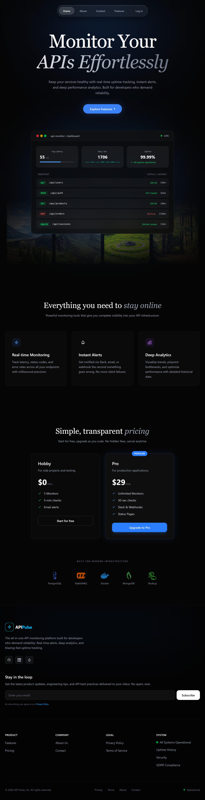
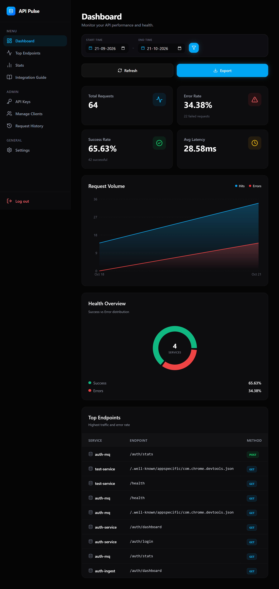

# API Monitor — Frontend

A web-based dashboard for monitoring API activity, analyzing endpoint performance, managing API keys, and viewing request analytics from a centralized interface.

This repository contains the frontend application for the API Monitor platform.

## 🔗 Related Repository

The API Monitor platform consists of a frontend dashboard and a backend service.

- **Frontend:** [Frontend-api-monitor-system](https://github.com/vansh12125/Frontend-api-monitor-system)
- **Backend:** [Api-Montior-System](https://github.com/vansh12125/Api-Montior-System)

## 📸 Screenshots

### Home Page



### Dashboard



### Integration Guide


## ✨ Features

- **Dashboard Analytics** — View API monitoring metrics and analytics.
- **Date Range Filtering** — Filter dashboard data using supported time ranges.
- **Request History** — Review recorded API request activity according to user permissions.
- **API Key Management** — Manage API keys and their associated permissions.
- **Integration Guide** — Access instructions for integrating applications with the monitoring platform.
- **Authentication and Authorization** — Access features according to the authenticated user's role.
- **Client Management** — Access client-related functionality based on permissions.
- **Privacy Policy and Terms of Service** — Review the platform's policies.

*Feature availability depends on the backend configuration and the authenticated user's permissions.*

## 🛠️ Tech Stack

- React
- JavaScript / TypeScript
- Vite
- CSS / Tailwind CSS
- REST API integration
- Git and GitHub

*Adjust this list to reflect the technologies actually used in the project.*

## 📂 Project Structure

```text
Frontend-api-monitor-system/
├── public/
│   ├── assets/
│   │   ├── error-bg.jpg
│   │   └── icon.png
│   └── screenshots/
│       ├── dashboard.png
│       ├── home.png
│       └── integration-guide.png
├── src/
├── .env.sample
├── .gitignore
├── eslint.config.js
├── index.html
├── jsconfig.json
├── package.json
└── README.md
```

## ⚙️ Prerequisites

Before running the application, ensure you have:

- [Node.js](https://nodejs.org/) installed.
- npm installed.
- Access to a running API Monitor backend.

## 🚀 Getting Started

### 1. Clone the repository

```bash
git clone https://github.com/vansh12125/Frontend-api-monitor-system.git
cd Frontend-api-monitor-system
```

### 2. Install dependencies

```bash
npm install
```

### 3. Configure environment variables

Create a `.env` file in the project root using `.env.sample` as a reference.

For example, if your frontend expects this variable:

```env
VITE_API_BASE_URL=http://localhost:5000/api/v1
```

Replace the URL with the actual backend API base URL and use the exact variable names expected by your application.

**Security note:** Never place private API secrets, database credentials, JWT signing keys, or other server-side secrets in frontend environment variables. Variables prefixed with `VITE_` can be exposed to users in the browser.

### 4. Start the development server

```bash
npm run dev
```

Open the local URL displayed in the terminal. Vite commonly uses:

```text
http://localhost:5173
```

### 5. Build for production

```bash
npm run build
```

### 6. Preview the production build

```bash
npm run preview
```

## 🔌 Backend Integration

The frontend communicates with the API Monitor backend through REST APIs.

Typical integration workflow:

1. Start the backend and its required database services.
2. Configure the frontend API base URL.
3. Sign in using an account supported by the backend.
4. Configure a client and API key, where permitted.
5. Follow the Integration Guide to connect an application.
6. Generate API activity and review available monitoring metrics.

The frontend and backend must use compatible API endpoints, authentication mechanisms, response formats, and authorization rules.

## 🔐 Security

- Never commit `.env` files containing sensitive information.
- Keep `.env.sample` limited to placeholder values.
- Never expose server-side credentials in frontend code.
- Use HTTPS in production.
- Enforce authorization on the backend for protected operations.
- Avoid exposing API key values in screenshots, logs, or documentation.

## 🧪 Code Quality

Run the available lint checks:

```bash
npm run lint
```

The command depends on the scripts configured in `package.json`.

## 🌐 Deployment

The production build can be deployed to a static hosting platform that supports Vite applications.

1. Connect the repository to your hosting provider.
2. Configure the required frontend environment variables.
3. Set the build command to `npm run build`.
4. Set the output directory to `dist`.
5. Configure the production backend URL.
6. Configure backend CORS to allow the deployed frontend origin.
7. Verify authentication, API requests, dashboard filtering, and protected features.

If the application uses client-side routing, configure the hosting provider to serve `index.html` for application routes.

## 🗺️ Future Improvements

Potential enhancements include:

- More detailed endpoint performance analytics.
- Advanced request filtering and search.
- Improved loading, empty, and error states.
- Automated frontend testing.
- Continuous integration for linting and production builds.

## 🤝 Contributing

Contributions and suggestions are welcome.

1. Fork the repository.
2. Create a feature branch.
3. Implement your changes.
4. Run the available lint and build checks.
5. Submit a pull request describing your changes.


## 👨‍💻 Author

**Vansh Sahu**

- GitHub: [@vansh12125](https://github.com/vansh12125)
- Repository: [Frontend-api-monitor-system](https://github.com/vansh12125/Frontend-api-monitor-system)